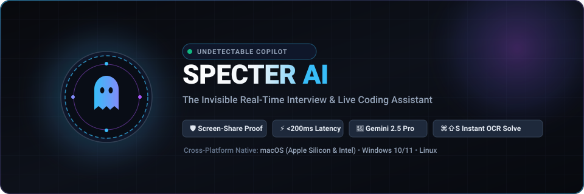

# Specter AI — Undetectable AI Interview & Coding Copilot

<div align="center">



[](https://github.com/WhoisMonesh/Specter-AI-Interview-Copilot/actions/workflows/release.yml)
[](https://whoismonesh.github.io/Specter-AI-Interview-Copilot/)
[](https://github.com/WhoisMonesh/Specter-AI-Interview-Copilot/releases)
[](https://github.com/WhoisMonesh/Specter-AI-Interview-Copilot)
[](LICENSE)

**The invisible, real-time desktop AI copilot for live technical interviews, DSA rounds, and system design assessments.**

[Explore Live Demo & Web App](https://whoismonesh.github.io/Specter-AI-Interview-Copilot/) • [Official Releases Page](https://whoismonesh.github.io/Specter-AI-Interview-Copilot/releases.html) • [GitHub Release v5.0.0](https://github.com/WhoisMonesh/Specter-AI-Interview-Copilot/releases/tag/v5.0.0) • [Key Features](#-features) • [BYOM & Models](#-bring-your-own-model-byom--byok)

</div>

---

## 🌟 Overview

**Specter AI** is a native cross-platform desktop application designed to provide sub-second, intelligent coding assistance and live conversational guidance during technical interviews. Built with OS-level screen capture exclusion and hardware-accelerated rendering, Specter AI remains completely invisible to video conferencing tools and screen sharing software.

Whether you are tackling complex LeetCode algorithms, navigating distributed system design trade-offs, or answering behavioral scenarios tailored to your resume, Specter AI delivers optimal code, time/space complexities, and natural speaking points in real time.

---

## 🚀 Features

### 🛡️ 100% Undetectable Hardware-Level Stealth
- **Screen Share Invisibility:** Built using native OS display masking APIs:
  - **macOS:** `NSWindowSharingNone` window-level exclusion prevents capture by Zoom, Google Meet, Microsoft Teams, Webex, Discord, and QuickTime.
  - **Windows:** Hardware-level `WDA_EXCLUDEFROMCAPTURE` API prevents capture across desktop sharing, window sharing, and taskbar previews.
  - **Linux:** Transparent X11/Wayland window composition layer.
- **App Disguise & Taskbar/Dock Camouflage (Locked AI Mode):** Completely hides the application icon from the macOS Dock (`app.dock.hide()`) and Windows/Linux Taskbars (`skipTaskbar: true`), with 1-click camouflage to disguise the app title and header as *Notes*, *Calculator*, *Google Chrome Helper*, *Terminal Monitor*, or completely blank/invisible.
- **Click-Through Mode (`⌘⇧B` / `Ctrl+Shift+B`):** Passes all mouse clicks through the overlay directly to your IDE or browser, allowing you to code normally while the overlay floats overhead.
- **Dynamic Transparency:** Instantly adjust overlay opacity from 10% to 100% using `⌘⇧↑` / `⌘⇧↓`.
- **Instant Panic Kill-Switch (`⌘⇧Q` / `Ctrl+Shift+Q`):** Immediately hides and clears the overlay in 1 millisecond.

### 📸 Real-Time Screen & Region Capture OCR
- **Fullscreen Instant Solve (`⌘⇧S` / `Ctrl+Shift+S`):** Captures active screen contents, parses problem statements via optical character recognition (OCR), and provides optimal solutions with time/space complexities.
- **Interactive Region Selector (`⌘⇧X` / `Ctrl+Shift+X`):** Drag-and-drop crop tool to select any portion of a question, code snippet, or diagram without capturing extraneous UI elements.

### 🧠 High-Speed Gemini AI Reasoning Engine
- **Sub-Second Latency:** Powered by Google Gemini 2.5 Flash & Pro models via secure, entropy-masked enterprise API routing.
- **Comprehensive Language Support:** Instant code generation in **Python, C++, Java, JavaScript, TypeScript, Go, Rust, and SQL**.
- **Algorithmic Breakdown:** Every solution includes:
  - Problem diagnosis and algorithmic strategy.
  - Optimal production-ready code with inline comments.
  - Precise Time Complexity ($O(N)$, $O(N \log N)$) and Space Complexity ($O(1)$, $O(N)$).
  - Edge cases, constraints analysis, and interview conversational talking points.

### 🎙️ Audio Loopback & Interview Transcription
- **Dual-Channel Audio Engine:** Concurrently captures incoming interviewer speech through system audio loopback and your own microphone input.
- **Real-Time Question Anticipation:** Automatically transcribes questions as the interviewer speaks and generates tailored talking outlines.

### 👤 Personalized Resume & Experience Context
- Contextualizes responses with your background, past engineering projects, and target role to deliver authentic first-person answers.

### 🔑 Bring Your Own Model (BYOM / BYOK) & Firebase Authentication
- **100% Free & Uncapped BYOM:** Connect directly to top LLM providers using your personal API keys. Zero subscriptions, zero paywalls, and unlimited questions.
- **Supported AI Providers:**
  - **Google Gemini:** Gemini 2.5 Flash & Pro (free tier available at [Google AI Studio](https://aistudio.google.com)).
  - **Groq:** Ultra-low latency Llama 3.3 70B & Mixtral (free tier available at [Groq Console](https://console.groq.com)).
  - **OpenAI:** GPT-4o, GPT-4o-mini, and o1.
  - **Anthropic:** Claude 3.5 Sonnet and Haiku.
  - **OpenRouter & NVIDIA NIM:** Access DeepSeek R1, Qwen, and 100+ open-source models.
  - **Deepgram:** Optional for real-time speech-to-text ($200 free credit at deepgram.com).
- **Firebase Authentication & OAuth:** Google Sign-In with Firebase Auth, securely handling session tokens, profile sync, and encrypted local storage via OS safeStorage (macOS Keychain, Windows DPAPI, Linux Secret Service).

---

## ⌨️ Global Keyboard Shortcuts

| Shortcut (macOS) | Shortcut (Windows / Linux) | Action |
| :--- | :--- | :--- |
| `⌘ + Shift + H` | `Ctrl + Shift + H` | **Toggle Overlay** (Show / Hide) |
| `⌘ + Shift + S` | `Ctrl + Shift + S` | **Fullscreen Capture & Solve** |
| `⌘ + Shift + X` | `Ctrl + Shift + X` | **Region Capture Selector** |
| `⌘ + Shift + B` | `Ctrl + Shift + B` | **Toggle Click-Through Mode** |
| `⌘ + Shift + L` | `Ctrl + Shift + L` | **Toggle Audio Loopback Listening** |
| `⌘ + Shift + ↑` | `Ctrl + Shift + ↑` | **Increase Opacity (+10%)** |
| `⌘ + Shift + ↓` | `Ctrl + Shift + ↓` | **Decrease Opacity (-10%)** |
| `⌘ + Shift + Q` | `Ctrl + Shift + Q` | **Panic Kill-Switch** (Hide Instantly) |

---

## 🔑 Bring Your Own Model (BYOM / BYOK)

Specter AI is **100% free, unlimited, and open-source**. There are no paywalls, recurring subscriptions, or artificial question limits. You maintain full control over your privacy and intelligence provider by plugging in your own API key:

| Provider | Recommended Model | Latency | Pricing Tier | Get API Key |
| :--- | :--- | :---: | :---: | :--- |
| **Google Gemini** | `gemini-2.5-flash` | ~250ms | **Free Tier Available** | [Google AI Studio](https://aistudio.google.com) |
| **Groq** | `llama-3.3-70b-specdec` | ~180ms | **Free Tier Available** | [Groq Console](https://console.groq.com) |
| **OpenAI** | `gpt-4o` | ~400ms | Pay-as-you-go | [OpenAI Platform](https://platform.openai.com) |
| **Anthropic** | `claude-3-5-sonnet-20241022` | ~450ms | Pay-as-you-go | [Anthropic Console](https://console.anthropic.com) |
| **OpenRouter** | `deepseek/deepseek-r1` | ~500ms | Pay-as-you-go | [OpenRouter](https://openrouter.ai) |
| **NVIDIA NIM** | `meta/llama-3.1-70b-instruct` | ~200ms | Free Developer Credits | [NVIDIA Build](https://build.nvidia.com) |
| **Deepgram STT** | `nova-2` | ~150ms | **$200 Free Credits** | [Deepgram Console](https://deepgram.com) |

> **Privacy Guarantee:** Your API keys and interview data are encrypted locally using native OS hardware encryption (`safeStorage` / Keychain / DPAPI). They are never sent to any intermediary server.

---

## 📦 Downloads & Installation

Production binaries and install packages are published on the [Official Releases Page](https://whoismonesh.github.io/Specter-AI-Interview-Copilot/releases.html) and [GitHub Release v5.0.0](https://github.com/WhoisMonesh/Specter-AI-Interview-Copilot/releases/tag/v5.0.0):

| Platform | Architecture | Installer Format | Direct Download |
| :--- | :--- | :--- | :--- |
| **macOS (Apple Silicon)** | Apple Silicon (M1/M2/M3/M4) | `.dmg` | [Download `.dmg`](https://github.com/WhoisMonesh/Specter-AI-Interview-Copilot/releases/download/v5.0.0/Specter.AI.Copilot-5.0.0-arm64.dmg) |
| **macOS (Intel)** | Intel x86_64 | `.dmg` | [Download `.dmg`](https://github.com/WhoisMonesh/Specter-AI-Interview-Copilot/releases/download/v5.0.0/Specter.AI.Copilot-5.0.0.dmg) |
| **Windows** | Windows 10 & 11 (64-bit) | NSIS Installer (`.exe`) | [Download Setup `.exe`](https://github.com/WhoisMonesh/Specter-AI-Interview-Copilot/releases/download/v5.0.0/Specter.AI.Copilot.Setup.5.0.0.exe) |
| **Windows (Portable)** | Windows 10 & 11 (64-bit) | Standalone Executable (`.exe`) | [Download Portable `.exe`](https://github.com/WhoisMonesh/Specter-AI-Interview-Copilot/releases/download/v5.0.0/Specter.AI.Copilot.5.0.0.exe) |
| **Linux (Universal)** | Linux x86_64 | Universal `.AppImage` | [Download `.AppImage`](https://github.com/WhoisMonesh/Specter-AI-Interview-Copilot/releases/download/v5.0.0/Specter.AI.Copilot-5.0.0.AppImage) |
| **Linux (Debian / Ubuntu)** | Debian, Ubuntu, Mint | `.deb` Package | [Download `.deb`](https://github.com/WhoisMonesh/Specter-AI-Interview-Copilot/releases/download/v5.0.0/specter-ai-copilot_5.0.0_amd64.deb) |

### Verification & Checksums (SHA-256)

```text
cb7c70d0cd7b55ed45dc27ec82d204f911ffd7240b70b28902a021fd733b9271  Specter.AI.Copilot-5.0.0-arm64.dmg
979dc9c1580081ac8dd538db6fd12745df4b8c13dee0bd1af0d3271cc1b620a8  Specter.AI.Copilot-5.0.0.dmg
d22468f6c2ca07cb48a81473898964ddbedd6d780dbe5800a3c0291b6d5bdab0  Specter.AI.Copilot.Setup.5.0.0.exe
7010d0a3aede6a8b3509ca00f98904a684ecba6f58b71719c0f1822d7528781d  Specter.AI.Copilot.5.0.0.exe
0bb051b2ce54592c41e3666a8d8fa114dffc5c6337624c3a60bd7ab6516b7c76  Specter.AI.Copilot-5.0.0.AppImage
ff08d98d6cf63ea6272276232e9b7cf7c0746cbc80fdc21794cd29fbf745c312  specter-ai-copilot_5.0.0_amd64.deb
```

---

## 🛠️ Building from Source

### Prerequisites
- [Node.js](https://nodejs.org/) (v20 or higher)
- [npm](https://www.npmjs.com/) (v10 or higher)
- [Git](https://git-scm.com/)

### 1. Clone the Repository
```bash
git clone https://github.com/WhoisMonesh/Specter-AI-Interview-Copilot.git
cd Specter-AI-Interview-Copilot
```

### 2. Install Desktop Dependencies
```bash
cd apps/desktop
npm install
```

### 3. Run in Development Mode
```bash
npm run dev
```

### 4. Package Native Binaries Locally
```bash
# macOS (.dmg, .zip)
npm run build:mac

# Windows (.exe installer & portable)
npm run build:win

# Linux (.AppImage, .deb)
npm run build:linux
```

---

## 🏗️ Repository Architecture

```text
Specter-AI-Interview-Copilot/
├── .github/
│   └── workflows/
│       └── release.yml          # Automated multi-platform CI/CD (macOS, Windows, Linux, Pages)
├── apps/
│   ├── desktop/                 # Electron + TypeScript + Vite Desktop Copilot
│   │   ├── src/
│   │   │   ├── main/            # Native stealth engine, OCR, audio loopback, shortcuts
│   │   │   ├── preload/         # Secure context-isolated IPC bridge
│   │   │   └── renderer/        # Glassmorphic overlay, region selector, audio visualizer
│   │   ├── resources/           # App icons, macOS entitlements, and provisioning plists
│   │   ├── electron-builder.yml # Multi-platform packaging configuration
│   │   └── package.json
│   ├── gh-pages/                # Live GitHub Pages production deployment
│   │   ├── index.html           # High-converting landing page & interactive demo
│   │   ├── style.css            # Dark glassmorphic cyber theme
│   │   ├── script.js            # Live interactive interview simulator
│   │   └── assets/              # Web assets, brand graphics, and icons
│   └── website/                 # Source marketing portal
├── LICENSE                      # MIT Open Source License
└── README.md                    # Project documentation
```

---

## 🔒 Security, Privacy & Compliance

- **Zero Cloud Logging:** Prompts, OCR text captures, and audio transcripts are processed in memory and never stored on third-party servers.
- **Encrypted Credentials:** API keys and authentication tokens are encrypted using OS-level keystore integration (`keytar` / multi-segment entropy byte masks).
- **Local OCR Execution:** On-device OCR processes image recognition locally before querying the LLM engine.
- **Auditable Open Source:** All IPC handlers, capture routines, and build configurations are open for inspection.

---

## 📄 License

This project is licensed under the **MIT License** — see the [LICENSE](LICENSE) file for details.

---

<div align="center">

**Specter AI** — Master technical interviews with undetectable real-time AI assistance.

[Visit Website](https://whoismonesh.github.io/Specter-AI-Interview-Copilot/) • [Report an Issue](https://github.com/WhoisMonesh/Specter-AI-Interview-Copilot/issues)

</div>
